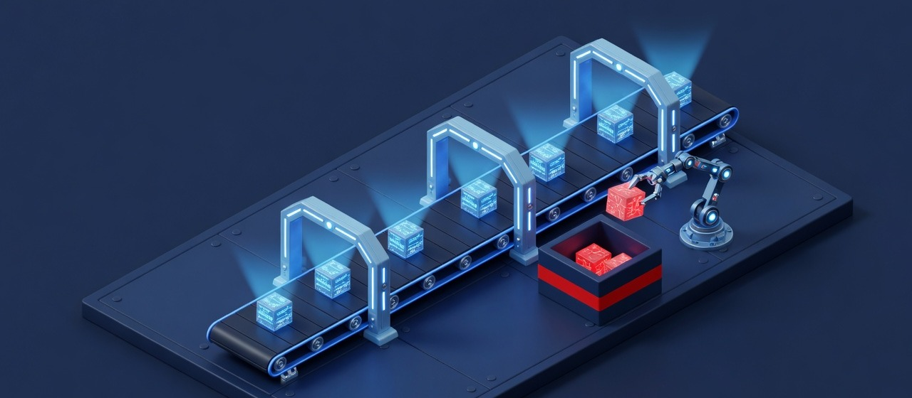

  
  <h1>Owen Pierce</h1>
  
<b>Security Engineer: cloud, DevSecOps, and offensive security.</b>

  
  

   owen, security engineer at Ally. $ cat ~/.history -> sre: ran production AWS with Terraform and CI/CD; soc: worked the queue as the team's AWS SME; sec eng: cloud and pipeline security, internal offensive testing. $ ls ~/focus -> ai-security, cloud-security, devsecops, infrastructure-as-code, pipeline-security, offsec.">

I sit on a team with threat hunting, detection engineering, and automation engineering. My lane is cloud and DevSecOps security: hardening AWS and CI/CD, writing the occasional detection, and assessing our own platforms the way an attacker would.

### Things I've built

| Project | What it does |
|:--|:--|
| **[reaper](https://github.com/sresarehumantoo/reaper)**    | JavaScript/TypeScript malware deobfuscation and triage. Static dead-code and obfuscation analysis plus a hardened Docker sandbox for dynamic runs. |
| **[wsmancer](https://github.com/sresarehumantoo/wsmancer)**    | PSRP-native WinRM shell for offensive Windows work. NTLM/Kerberos message sealing, typed JSON output, sessions that survive dropped connections. |
| **[rummage](https://github.com/rummage-dev/rummage)**    | TUI file picker and fuzzy finder library for Go, built on Bubble Tea. |
| **[dotfiles](https://github.com/sresarehumantoo/dotfiles)**    | Idempotent, reversible workstation configurator for Linux and macOS, with dry-run and drift detection. |
| **[htb-hosts](https://github.com/sresarehumantoo/htb-hosts)**    | Sudo-free `/etc/hosts` manager for Hack The Box, as a CLI and a zero-dependency MCP server. |

**Upstream:** [neovim/neovim: treesitter foldexpr parsing mid-change](https://github.com/neovim/neovim/pulls?q=author%3Asresarehumantoo)

### Behind the curtain

Most of my infrastructure work lives in a private GitLab: about 100 Ansible roles and Terraform across 25+ repos running a segmented homelab.

  
  
  
  
  
  
  
  

- Zero standing privilege: Vault with default-deny, short-lived scoped tokens so automation and AI agents never hold admin credentials
- 15 segmented VLANs behind Suricata inline IPS; Headscale, Teleport (WebAuthn), and Authelia SSO for access
- An Active Directory attack range built from a Packer golden image, with Terraform and Ansible injecting repeatable misconfigurations
- Routers, DNS/DHCP, hypervisors, and services converge from Ansible and Terraform in CI

### Certifications

HTB CPTS · HTB CDSA · AWS Solutions Architect Associate · HashiCorp Terraform Associate · CompTIA CySA+ · CompTIA Security+
